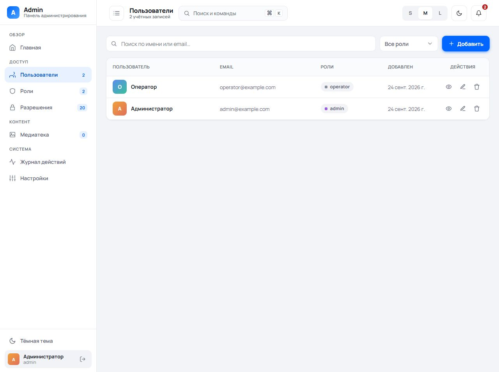
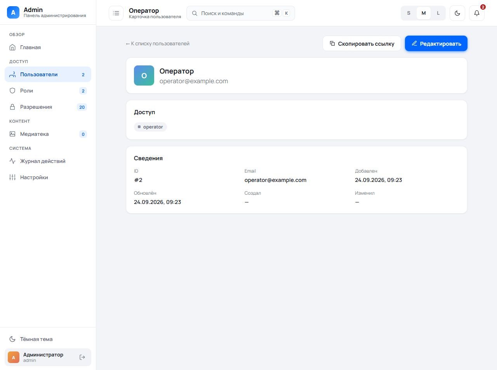
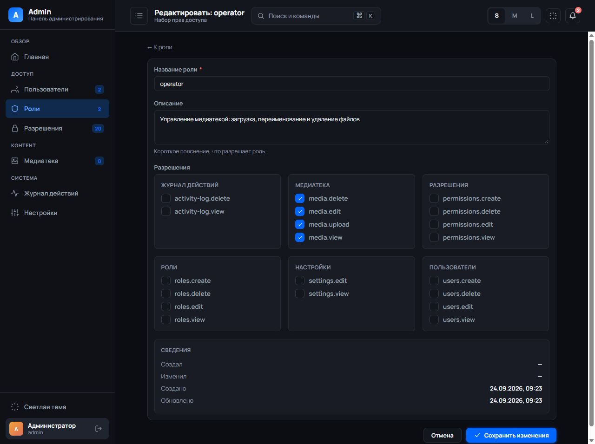
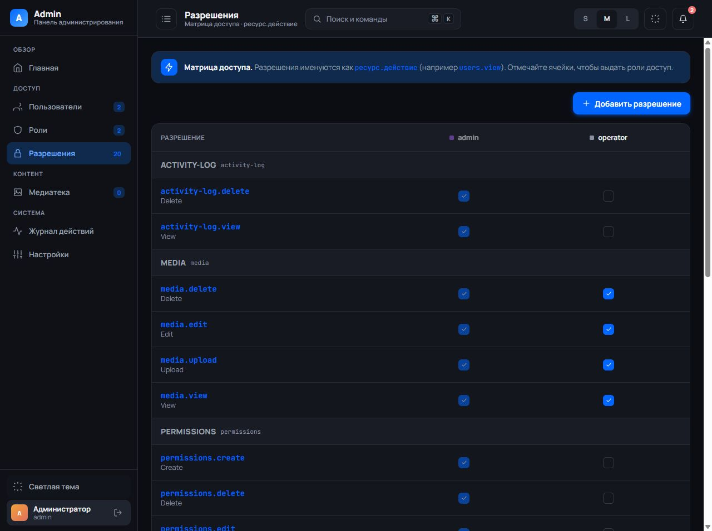

# Laravel Admin Template

An admin-panel template built on **Laravel 12** + **Inertia 3** + **Vue 3.5** (SPA) with the **nergous-ui-vue** design system:

- SPA on Inertia + Vue with the **nergous-ui-vue** design system (light/dark theme, nine accent colors, command palette);
- **RBAC** via [spatie/laravel-permission](https://spatie.be/docs/laravel-permission) — roles, permissions, a granular access matrix, record-level policies and protection against privilege escalation;
- Dedicated user and role pages for viewing, creating, and editing records, with shareable detail URLs; a user trash with permanent deletion;
- A media library with uploads (synchronous by default, queued with the `database` queue), WebP/AVIF conversion, folders, cropping, a focal point and a reusable picker that can upload;
- An activity log (`activity_log`, the `ActivityOccurred` event + the `LogsActivity` model concern) with a JSON diff of changes and CSV/XLSX export;
- Application settings (typed key/value), database backups, a job queue page and a dashboard with a "needs attention" card.

Use it as a starting point for new projects: clone → remove the demo seeders → add your own entities (see ["How to add your own entity"](#how-to-add-your-own-entity)).

## Interface preview

Screenshots of the running admin panel with the template's demo accounts in an
isolated SQLite database. The interface is in Russian; light and dark themes and
an accent color chosen in the settings are available.

**Users — search, role filters, sorting, and links to view or edit each account.**



<details>
<summary>User details — share a record with another administrator</summary>

Each user has a stable detail URL, a copy-link action, assigned roles, and a
separate editing page. Roles follow the same view/create/edit pattern.



</details>

<details>
<summary>Role editor — grouped permissions in the dark theme</summary>

Edit a role's description and permissions on a dedicated page. Permissions are
grouped by resource.



</details>

<details>
<summary>Access matrix — compare permissions across roles</summary>

Manage role access from one matrix. The system administrator's permissions stay
enabled and protected from editing.



</details>

---

## Stack

- **PHP** ^8.4 · **Laravel** ^12
- **Inertia** ^3 (`inertiajs/inertia-laravel`) · **Vue** ^3.5 + **TypeScript** — SPA (a single Blade template, everything else in Vue)
- **Vite** 8 · **nergous-ui-vue** 1.2.0 from npm, a Vue component library with no runtime dependencies beyond Vue
- **spatie/laravel-permission** ^8 (RBAC)
- **SQLite** by default (compatible with MySQL/MariaDB/PostgreSQL)
- Queues: `QUEUE_CONNECTION=sync` by default — jobs (media processing, manual backups) run inside the request, no worker needed; the `database` driver is supported when you want them in the background

---

## Requirements (manual installation)

None of this is needed for the [Docker](#docker) path — the extensions and versions are
baked into the image. For running locally without Docker:

- **PHP** 8.4+ with the `pdo_sqlite` (the default database), `gd` with WebP support
  (media optimization; without it originals are stored without thumbnails — `ImageOptimizer`
  silently falls back), `exif` (JPEG orientation), `mbstring`, and `intl` extensions.
- **Composer** 2.
- **Node.js** ≥ 20.19 or ≥ 22.12 (required by Vite 8) + npm.
- For backups of MySQL/MariaDB or PostgreSQL: the database client tools
  (`mariadb-dump`/`mysqldump`, `pg_dump`) on the `PATH` or in `BACKUP_BINARY_PATH`.

## Quick start

```bash
git clone <repo> my-new-project
cd my-new-project

cp .env.example .env            # Windows (PowerShell): copy .env.example .env
composer install
npm install
php artisan key:generate

# Create the database (for SQLite — an empty file)
touch database/database.sqlite  # Windows (PowerShell): New-Item database/database.sqlite

php artisan migrate --seed      # creates the admin/operator roles and test users
php artisan storage:link        # symlink public/storage → serves uploaded media (otherwise 404)
npm run build
php artisan serve
```

Uploads and manual backups run synchronously (`QUEUE_CONNECTION=sync`), so no
queue worker is needed. With `QUEUE_CONNECTION=database`, also run
`php artisan queue:work` (see [Troubleshooting](#troubleshooting)).

After `--seed`, the following will be available:

- `admin@example.com` / `password123` (the `admin` role, all permissions)
- `operator@example.com` / `password123` (the `operator` role, media library only)

**Do not use the seeder in production.** To remove the test users: drop `UserSeeder::class` from `DatabaseSeeder`, or run `php artisan app:create-admin` to create a proper admin and delete them through the UI.

### Composer scripts

| Command              | Purpose                                                                                                                                                                          |
| -------------------- | ------------------------------------------------------------------------------------------------------------------------------------------------------------------------------- |
| `composer setup`     | Turnkey setup for SQLite: composer/npm + SQLite file + migrations + seeds (roles/permissions + demo users in `local`) + `storage:link` + build. Afterwards you can log in immediately as `admin@example.com` / `password123` |
| `composer dev`       | In parallel: artisan serve, pail (logs), vite. No queue listener: the default queue is `sync`                                                                                   |
| `composer test`      | Runs PHPUnit (`tests/Feature` and `tests/Unit`) on SQLite in memory; the tests use their own config cache file, so the working one is left alone                              |
| `composer doc:routes`| Regenerates [docs/api/routes.snapshot.txt](docs/api/routes.snapshot.txt) (`php artisan route:list`)                                                                            |

The frontend is built with Vite: `npm run dev` — a dev server with HMR, `npm run typecheck` — strict TypeScript/Vue check, `npm run build` — a production build. `npm run test:js` runs the frontend logic tests (`node --test`), `npm run test:e2e` runs the Playwright and axe browser tests against a fresh SQLite file of their own (build first; `npx playwright install chromium` once). See [docs/frontend.md](docs/frontend.md).

### Creating an administrator

```bash
php artisan app:create-admin admin@example.com "Administrator Name"
```

The command seeds the base RBAC itself (the permission catalog + granting them to the
superadmin role, idempotently) and assigns the role to the user. As a result it produces a
**working** admin even on a fresh database with no seeds (after a bare `migrate`) — without
it the superadmin role would be left with no permissions, and the admin would get a 403 in
every section.

The first production admin can also be created by the seeder: `ADMIN_EMAIL`,
`ADMIN_NAME` and `ADMIN_PASSWORD` (`config('rbac.initial_admin')`) are used by
`UserSeeder` on an empty database (`php artisan app:seed-fresh --users` or
`RUN_SEEDS=true` in Docker); without `ADMIN_PASSWORD` no account is created.

**Password policy:** passwords set through this command or the users UI require at least
15 characters, upper- and lowercase letters, a digit and a symbol. The UI can generate
and copy a 20-character password. Demo seed passwords bypass validation; replace demo
accounts before production use.

---

## Docker

The image is multi-stage, based on the stock **FrankenPHP** image (Caddy + PHP 8.4 in a
single process). PHP extensions: `pdo_mysql`, `pdo_sqlite`, `gd` (WebP), `exif`, `intl`,
`bcmath`, `pcntl`, `zip`, `mbstring`, `opcache`. The image also ships the MariaDB client
(`mariadb-dump`/`mariadb`) for backups and restores. There is no PostgreSQL driver or
client in the image: add `pdo_pgsql` and `postgresql-client` to the `Dockerfile` if you
run on PostgreSQL. The application runs as the unprivileged `www-data` user.

### Development (hot reload)

`compose.dev.yaml` brings up: `app` (FrankenPHP, code mounted via bind-mount,
PHP changes are picked up), `vite` (HMR on `:5173`) and `db` (MariaDB). Every port
is published on `127.0.0.1` only.

```bash
cp .env.example .env          # the defaults (local, debug) are fine as-is
docker compose -f compose.dev.yaml up --build
```

- Application: <http://localhost:8000> · Vite HMR: <http://localhost:5173>
- `vendor/` and `node_modules/` are installed automatically on first start
  (into named volumes, to avoid conflicting with host permissions).
- In dev, `RUN_SEEDS=true` — demo roles and test users are created only when the
  database is empty. Restarts leave existing users and permissions untouched.

### Production (self-contained stack)

`docker-compose.yml` brings up: `app` (web), `scheduler` (`schedule:work`) and
`db` (MariaDB), with named volumes for data. There is no Redis and no queue worker:
sessions and cache live in the database, jobs run synchronously
(`QUEUE_CONNECTION=sync`). Code and dependencies are baked into the image
(immutable); only `storage` is mounted out. The step-by-step server guide
(nginx, `.env`, first start, updates, backups, monitoring) is
[docs/deploy.md](docs/deploy.md).

```bash
cp .env.example .env
# Set in .env:
#   APP_ENV=production, APP_DEBUG=false, APP_URL=https://your-domain
#   APP_KEY=...                      (required; generate it with `php artisan key:generate --show` and paste it in.
#                                     In production the entrypoint does NOT generate it — it fails with an error,
#                                     so the key persists across restarts)
#   DB_* for the db service, DB_PASSWORD and DB_ROOT_PASSWORD (required, no defaults)
# Set RUN_MIGRATIONS=true for this first boot; return it to false after provisioning.

docker compose up -d --build
```

- The application listens on `127.0.0.1:${APP_PORT}` (default `8888` → container `:8000`)
  only: put nginx (or another TLS proxy) on the same host in front of it
  (`docker/nginx.conf.example`). The application stays on HTTP behind it. To receive the
  client's real IP, `TRUSTED_PROXIES` must cover the proxy; the compose file defaults it
  to the Docker bridge range. Untrusted proxies cannot spoof `X-Forwarded-For` (this
  protects the login throttle). In production the session cookie is marked `Secure`
  automatically (`SESSION_SECURE_COOKIE`).
- Migrations run with `RUN_MIGRATIONS=true` (default `false`). Enable this for first
  boot or a release, then return it to `false` before ordinary rebuilds. Base RBAC
  is seeded only if the migrated database has no application data; subsequent
  restarts and releases preserve existing roles and permissions. The `scheduler`
  does not migrate.
- **Base RBAC** (roles + permissions) is initialized once for an empty database.
  **Demo/production USERS** are included on that first initialization only when
  `RUN_SEEDS=true` (default `false` in production). If the database already has
  application data, both kinds of seeds are skipped. Create an admin:
  `docker compose exec -it app php artisan app:create-admin ...` (`-it` is required — the
  command prompts for a password interactively), or set `RUN_SEEDS=true` +
  `ADMIN_PASSWORD` so the production admin is created automatically. Either way, the admin
  gets the full set of permissions out of the box.
- **The production database is not SQLite.** Set the `DB_*` block in `.env`
  (`DB_CONNECTION=mariadb`, `DB_HOST=db`, …). If you leave the default
  `DB_CONNECTION=sqlite`, the entrypoint **fails with a clear error**: SQLite in a container
  is ephemeral and would lose data on recreation. For a deliberate SQLite on a persistent
  volume — `ALLOW_SQLITE_IN_PRODUCTION=true`.
- The database (`db`) is not published externally — it is reachable only within the stack's network.
  To use an external database, set `DB_HOST` to the external address and remove the
  `db` service (+ its `depends_on`).
- Want background jobs? Set `QUEUE_CONNECTION=database` and add a service running
  `php artisan queue:work` from the same image.

Useful commands:

```bash
docker compose logs -f app                       # application logs
docker compose exec app php artisan migrate      # manual migration
docker compose exec app php artisan tinker       # console
docker compose down                              # stop (volumes are kept)
docker compose down -v                           # tear down along with data
```

---

## What's included

### Out of the box

| Section          | URL                   | Permission          |
| ---------------- | --------------------- | ------------------- |
| Dashboard        | `/admin`              | (auth only)         |
| Users            | `/admin/users`        | `users.view`        |
| Roles            | `/admin/roles`        | `roles.view`        |
| Permissions      | `/admin/permissions`  | `permissions.view`  |
| Media library    | `/admin/media`        | `media.view`        |
| Activity log     | `/admin/activity-log` | `activity-log.view` |
| Settings         | `/admin/settings`     | `settings.view`     |
| Backups          | `/admin/backups`      | `backups.view`      |
| Job queue        | `/admin/queue`        | `queue.view`        |
| My profile       | `/admin/profile`      | (auth only)         |

> The "Permission" column is access to the section (viewing). Actions are gated **granularly** by `permission:` route middleware: create/edit — `*.create`/`*.edit`, delete — `*.delete`, re-checked in the FormRequest. Record-level rules (a user or role above the actor) come from the policies `UserPolicy`/`RolePolicy` via `can:` middleware and answer 403. For media: upload — `media.upload`, rename, crop and folders — `media.edit`, delete — `media.delete`. Settings: write — `settings.edit`. Users: CSV/XLSX export — `users.export`. Backups: download — `backups.download`. If you create a custom role with `*.view` but without `*.delete`, the server-side protection still kicks in (403), but you should also hide the delete buttons in the UI via `can('*.delete')` (see `resources/js/lib/can.ts`). The full route map is in [docs/api/permissions-matrix.md](docs/api/permissions-matrix.md).

### Base permissions

The `RolePermissionSeeder` seeder creates:

- `users.{view,create,edit,delete,export}`
- `roles.{view,create,edit,delete}`
- `permissions.{view,edit}`
- `media.{view,upload,edit,delete}`
- `activity-log.{view,delete}`
- `settings.{view,edit}`
- `backups.{view,download,create,delete}`
- `queue.{view,manage}` (`manage` — retry and delete failed jobs)

Permissions are defined in code only: `RolePermissionSeeder::PERMISSIONS` for a fresh
install and migrations through `App\Support\Migrations\PermissionMigration`
(`add()` grants a new permission to the superadmin and to the holders of an existing one,
`rename()` keeps the grants) for existing databases. The panel toggles the role ×
permission matrix but cannot create, rename or delete a permission.

Roles: `admin` — all permissions (the superadmin, `config('rbac.superadmin_role')`); `operator` — media library only (`media.*`). Both are system roles (`roles.is_system`): they cannot be deleted or renamed.

Add your own using the `module.action` format — the roles UI groups checkboxes by the prefix before the dot.

### Settings

The `/admin/settings` section is a typed key/value store (`App\Models\Setting`, read
through the request-scoped `App\Services\System\Settings`). Its structure is defined by
`App\Support\Settings\SettingsSchema::FIELDS` (group → key → `[type, default]`); the page
has four tabs:

- **Общие** (`general`) — application name, timezone, favicon;
- **SEO** (`seo`) — title template, description, canonical domain, OG image, indexing, sitemap;
- **Безопасность** (`security`) — session lifetime, the `login_throttle` login-attempt limit;
- **Оформление** (`appearance`) — the admin accent color, one of nine presets
  (`App\Enums\AccentPreset`) for all users.

Values are cached and invalidated on write; validation is handled by
`UpdateSettingsRequest` (`App\Support\Settings\SettingsRules`). The application name
from the settings is shown in the panel; `config('app.name')` is only its fallback and is
not overwritten. Session lifetime is applied per request by the `ApplyRuntimeSettings`
middleware.

Dates are stored in UTC. The `timezone` setting only controls how the admin panel
*displays* dates (and how date filters/exports interpret days).

The SEO group feeds `resources/views/public.blade.php`, a root layout for the public part
of the site (title template, description, canonical, robots, favicon, Open Graph, via
`App\View\Composers\SeoMetaComposer`). Extend it from your pages and override per page with
`@section('title')`, `@section('description')`, `@section('og_image')`. Print stored HTML
with the sanitizing Blade directives `@html`, `@htmlText`, `@htmlWithoutLinks` and
`@htmlInline` (`App\Support\Html\HtmlSanitizer`).

`/robots.txt` and `/sitemap.xml` are generated by `Site\RobotsController` and
`Site\SitemapController` from the same settings. With `indexable` off, robots.txt closes the
whole site; with it on, only `/admin` is closed, and the `sitemap` flag publishes
`/sitemap.xml` and announces it in robots.txt. The template has no public pages, so the
sitemap starts empty: add a `SitemapSource` and tag it with `Sitemap::SOURCES` (see
[step 11](#how-to-add-your-own-entity) below). Admin responses always carry
`X-Robots-Tag: noindex, nofollow`.

> **For your own project:** the branding defaults (`app_name`, `meta_title_template`,
> `meta_description`) in `SettingsSchema::FIELDS` are neutral placeholders; replace them
> here or through the UI. The `/admin` dashboard is also a demo: its cards are tied to the
> template's entities — rewrite it for your own domain (`DashboardController`,
> `App\Services\System\Dashboard\*` + `pages/Dashboard.vue`).

### UI features

- **Light/dark theme** via `useTheme` from nergous-ui-vue; the choice is stored in
  `localStorage`, and an anti-flash script in `admin.blade.php` applies it before the CSS
  loads. **Accent color** from the settings is set on `<html data-accent>` on the server.
- **Sidebar** with the brand icon (the favicon from the settings) and an "Открыть сайт" link.
- **Command palette and global search** via `Ctrl/Cmd+K` (`useHotkeys` from nergous-ui-vue,
  layout-independent; new hotkeys are added through the same composable).
- **Toasts** for flash messages (`success`/`error`/`warning`/`info`) via `useToast`/`NToaster`.
- **Session expiry** — a minute before an idle session ends, a modal offers to stay signed
  in; while the user is active the session is kept alive even on one page. Background polling
  pauses when idle, and any request that hits an expired session (401/419) shows a toast and
  leads back to the login page instead of failing silently.
- **Accounts** — blocking (`is_active`) with an optional reason, last-login time, and a
  self-service profile with active sessions (`/admin/profile`). Changing the email asks for
  the current password; changing the password keeps "remember me" on the current device and
  ends it on the others.
- **Users list** — role and status filters, sorting by last login, bulk block/unblock with
  an optional reason (shown on the user page), CSV/XLSX export of the current selection, a
  column picker remembered in the browser, a password generator in the form and the user's
  recent activity on their page. Deleting moves to the trash; the "Удалить навсегда"
  checkbox in the delete dialog deletes permanently. "Back to list" links on the user and
  role pages return to the list with its filters and page.
- **Activity log** — filters by action, object type, user and dates (date pickers in the
  display timezone), CSV/XLSX export with a column choice, links to the affected records
  (only where the viewer may open them), a per-record history (`subject_type` +
  `subject_id`); logins (with IP, browser and the reason of a failure), logouts, ended
  sessions, settings changes (with a diff) and permission matrix changes are recorded. The
  diff highlights the changed part of long values and lists.
- **Media library** — server-side type filter, search, sorting and page size, file details,
  copying the link, replacing the file behind an existing record, alt text and folders
  (with a bulk "move to folder"), upload checks before sending, failed-upload reports,
  and a warning before deleting a file in use. JPEG orientation from EXIF is applied during
  conversion. Also: cropping with aspect presets, a focal point that keeps the subject in
  view in cropped previews, skipping duplicate uploads (same content), a "used / unused"
  filter, renaming and clearing folders, dragging files onto a folder, and responsive copies
  served through `srcset` (WebP, or AVIF with `MEDIA_IMAGE_FORMAT=avif` when GD supports
  it). `MediaPicker` (with `MediaField`) picks files on other forms and can upload new ones
  for holders of `media.upload`; `HtmlEditor` is a rich-text field with a raw HTML mode.
- **Backups** — list, download, delete and on-demand creation of `app:db-backup` dumps
  (with a pending state and the last failure shown on the page); see [Backups](#backups).
- **Job queue** — pending jobs, the oldest waiting job and failed jobs with retry/delete.
- **Dashboard** — users and blocked users, sign-ins and failed sign-ins over 24 hours,
  media library size and images without alt text, recent activity and a "Требует внимания"
  card (failed jobs, a stalled queue, a missing backup or one older than 48 hours), each
  shown only with the matching permission.
- **Accessibility**: focus trap and scroll lock in overlays (modals/drawers/palette),
  Escape to close, ARIA markup, and `prefers-reduced-motion` support.
- **Bulk operations** in tables (users, the user trash, media) for the picked rows or every
  row matching the filters, with server-side sorting/filtering.

### Media storage

Media library files go to the disk set in `MEDIA_DISK` (default `public`, needs
`storage:link`). For S3 or a compatible store, set `MEDIA_DISK=s3`, fill in the `AWS_*`
variables (`AWS_URL` for a CDN or public bucket URL, `AWS_ENDPOINT` for MinIO) and run
`composer require league/flysystem-aws-s3-v3`. Files must be publicly readable. The
production CSP allows the disk's origin automatically. Changing the disk does not move
files that were already uploaded. `php artisan media:prune-orphans` (daily in the
scheduler) removes files no media record refers to.

### Backups

`app:db-backup` writes `db-YYYYmmdd-HHiiss[-tag].sqlite|sql` (UTC) to `BACKUP_PATH`
(default `storage/app/backups`). SQLite is dumped with `VACUUM INTO`, MySQL/PostgreSQL
with their dump tools. The scheduler runs it daily. Scheduled and manual (`--tag=manual`,
the UI button) dumps are rotated separately: `BACKUP_KEEP` (7) and `BACKUP_KEEP_MANUAL` (5).

- **Dump tools** — MySQL/MariaDB uses `mariadb-dump` when available, otherwise `mysqldump`;
  PostgreSQL uses `pg_dump --clean --if-exists`. The Docker image ships the MariaDB client
  only; a manual install needs the tools on the `PATH` (or in `BACKUP_BINARY_PATH`).
  `BACKUP_TIMEOUT` (600 s) limits a dump.
- **Verification** — every dump is checked before it is kept: SQLite with
  `PRAGMA integrity_check`, SQL dumps by the tool's completion marker. A failed check
  deletes the file and reports an error.
- **The UI button** dispatches a `CreateBackup` job. With the default `sync` queue the
  dump is made during the request and the result is reported right away; with the
  `database` queue a worker must be running. A second dump is refused while one is pending.
- **Restore** — `php artisan app:db-restore <file> --force` restores SQLite, MySQL and
  PostgreSQL dumps after taking a `prerestore` safety dump (`--no-safety-backup` skips it).
  Stop the scheduler (and a queue worker, if you run one) first.
- **Dumps are not encrypted.** They hold every password hash, so downloading needs its own
  `backups.download` permission; protect `BACKUP_PATH` and the offsite disk accordingly.
- **Offsite copy** — set `BACKUP_DISK` (a filesystem disk) and `BACKUP_DISK_PATH`; every dump
  is uploaded there with the same rotation. Deleting a dump in the UI removes only the local file.

---

## How to add your own entity

A recipe for the current conventions. `Xxx` is the entity, `<Section>` the folder it
belongs to (`Access`, `Content`, `System`, …); the role classes are the reference for most
steps.

1. **Migration + model + factory.** Keep the model thin and wire up the concerns from
   `App\Models\Concerns` (each has a precondition — don't skip it):
   - `SoftDeletes` — the trash; add `$table->softDeletes()` to the migration.
   - `LogsActivity` — logs created/updated/deleted (+ restored) with a JSON diff; hidden
     attributes are skipped, list noisy columns in `protected array $auditExclude`. So the
     subject type is named readably, register the class in `config/activity.php`
     (`subjects`: FQCN → key) with a label in `lang/ru/activity.php` (`subjects`); for a link
     from the log to the record add the type to `App\Services\System\ActivitySubjectLinks`.
   - `TracksAuthor` — fills `created_by`/`updated_by` and gives `creator()`/`editor()`.
     **Requires columns** in the migration, otherwise the INSERT fails:
     `$table->foreignId('created_by')->nullable()->constrained('users')->nullOnDelete();`
     and the same for `updated_by`.
   - `HasSearch` — declare `protected array $searchable = ['name', /* ... */];` and the
     model gets `->search($term)` (escaped `LIKE` over those columns).
   - Status-like columns: a string-backed enum in `app/Enums` with
     `App\Enums\Concerns\HasLabel` (labels in `lang/ru/enums.php`, `enums.<Enum>.<Case>`).

   Create a `database/factories/XxxFactory.php` factory — seeders and tests rely on it
   (reference: `database/factories/UserFactory.php`).
2. **Permissions.** Add `xxx.{view,create,edit,delete}` to
   `RolePermissionSeeder::PERMISSIONS` (fresh installs) **and** in a migration call
   `PermissionMigration::add(['xxx.view' => null, ...])` (existing databases; the value names
   a permission whose holders inherit the new one, `null` — the superadmin only; reference:
   `database/migrations/2026_09_25_000003_add_granular_permissions.php`). Rename with
   `PermissionMigration::rename()`. Add the group label for the access matrix in
   `lang/ru/permissions.php` (`resources`).
3. **Requests** in `app/Http/Requests/<Section>/`:
   - `XxxFilterRequest` — the list query: filter `rules()`, `authorize()` re-checking
     `xxx.view`, and the `SortsList` (whitelist in `sortable()`) and `PaginatesList` traits
     from `App\Http\Requests\Concerns` (reference: `RoleFilterRequest`). Add `ChoosesExport`
     for an export.
   - `XxxRequest` (or `StoreXxxRequest`/`UpdateXxxRequest`) — the form; `authorize()`
     re-checks `xxx.create` / `xxx.edit`.
   - Bulk actions: a subclass of `App\Http\Requests\SelectionRequest` (`permissions()` and
     the list's `filterRules()`; ids are capped at 500).
4. **Service** `App\Services\<Section>\XxxService` — the list query, create/update/delete in
   transactions, domain invariants as
   `Illuminate\Validation\ValidationException::withMessages([...])` (Laravel redirects back
   with the error under the right key, the controller needs no `try/catch`), explicit log
   entries with `ActivityOccurred::by($actor, $model, 'action', $changes)` and bulk actions
   with `App\Support\Selection::each()`. A record still referenced elsewhere throws
   `App\Exceptions\ReferenceInUseException` (shown as a flash error). References:
   `RoleService`, `UserService` (unit-tested in `tests/Unit/Services/`).
5. **API Resource** `App\Http\Resources\<Section>\XxxResource` — the only shape the
   frontend sees, with snake_case keys and `can_*` flags for buttons (reference:
   `RoleResource`). Describe it in `resources/js/admin/types.ts`.
6. **Policy** `App\Policies\XxxPolicy` — only when some records are off-limits to some
   holders of the permission (reference: `RolePolicy`). It is auto-discovered by name; the
   superadmin passes it through `Gate::before`.
7. **Controller** `App\Http\Controllers\Admin\<Section>\XxxController` — thin: takes the
   FormRequest, calls the service, wraps records in the Resource and returns
   `Inertia::render('Xxx/Index', [...])` or a redirect (`redirectToList()`,
   `redirectPastLastPage()`). Reference: `Admin\Access\RoleController`.
8. **Routes** in `routes/web.php`, inside the authenticated `/admin` group:

   ```php
   Route::middleware('permission:xxx.view')->group(function () {
       Route::name('admin')->resource('xxx', XxxController::class)->except('destroy')
           ->middlewareFor(['create', 'store'], 'permission:xxx.create')
           ->middlewareFor(['edit', 'update'], ['permission:xxx.edit', 'can:update,xxx']);
   });

   Route::middleware('permission:xxx.delete')->group(function () {
       Route::name('admin')->resource('xxx', XxxController::class)->only('destroy')
           ->middlewareFor('destroy', 'can:delete,xxx');
   });
   ```

   Drop the `can:` parts without a policy. Then run `composer doc:routes`. See
   [the permission matrix](docs/api/permissions-matrix.md) for the complete route rules.
9. **Inertia page + sidebar** — Vue components under `resources/js/admin/pages/Xxx/`
   (`Index.vue`, `FormPage.vue`, `Show.vue`); import design-system elements from
   `nergous-ui-vue`. `AdminLayout` is persistent, so the page sets its title and breadcrumbs
   with `usePageHeader()`. List pages combine library pieces (`NToolbar`, `NMultiSelect`,
   `NFilterChips`, `NDataTable stacked`, `NConfirmDialog`, `TrashConfirmDialog` for records
   with a trash, `NActionBar` for forms) with local helpers (`useIndexFilters`,
   `useBulkSelection`, `AdminPagination`, `can`, `format`); URLs are plain strings (no
   Ziggy). Add the sidebar item to `buildNavSections()` in
   `resources/js/admin/layouts/partials/nav.ts` (`perm` gates visibility); a badge count goes
   into `App\Services\System\SidebarCounts::SECTIONS`. Details in
   [docs/frontend.md](docs/frontend.md).
10. **Media references** — if the entity stores media files, register its columns in
    `App\Services\Media\MediaReferenceRegistry`: `FOREIGN_KEYS` for `media.id` columns,
    `TEXT_FIELDS` for HTML/URL columns (with `model`, so `MediaTextObserver` is attached
    automatically). Deletion protection, the "used / unused" filter and link rewriting after
    a replace or crop then cover it. Extend `MediaPlaces` (`owners()`, `place()`) to show the
    owner's title and edit link in the file details.
11. **Public pages (optional)** — for `/sitemap.xml`, implement
    `App\Services\Site\SitemapSources\SitemapSource` (returning `SitemapEntry` objects) and
    tag it in a service provider:
    `$this->app->tag([XxxSitemapSource::class], Sitemap::SOURCES);`.
12. **Global search (optional)** — so the entity is found via `Ctrl/Cmd+K`, add a private
    method to `App\Services\System\GlobalSearch` and one line to `find()` (gated by
    `xxx.view`).
13. **Tests** — modeled on `tests/Feature/RoleManagementTest.php` (HTTP + permissions) and
    `tests/Unit/Services/RoleServiceTest.php` (domain logic without HTTP).

---

## Security (HTTP headers and CSP)

The `App\Http\Middleware\SecurityHeaders` middleware (registered in `bootstrap/app.php` for the web group) adds to every response:

| Header                      | Value                                      | When                                                    |
| --------------------------- | ------------------------------------------ | ------------------------------------------------------- |
| `X-Frame-Options`           | `DENY`                                     | always (anti-clickjacking)                              |
| `X-Content-Type-Options`    | `nosniff`                                  | always                                                  |
| `Referrer-Policy`           | `strict-origin-when-cross-origin`          | always                                                  |
| `X-XSS-Protection`          | `0`                                        | always (disables the buggy legacy auditor; protects the CSP) |
| `Permissions-Policy`        | `camera=(), microphone=(), geolocation=()` | always                                                  |
| `X-Robots-Tag`              | `noindex, nofollow`                        | on `/admin` responses                                   |
| `Strict-Transport-Security` | `max-age=31536000; includeSubDomains`      | only over HTTPS                                         |
| `Content-Security-Policy`   | strict, with a per-request **nonce**       | **only in `production`**                                |

The policy is built by `App\Services\System\ContentSecurityPolicy`:

```
default-src 'self'; script-src 'self' 'nonce-…'; style-src 'self' 'unsafe-inline';
img-src 'self' data: https: <hosts>; media-src 'self' <media disk>; frame-src 'self' <media disk>;
font-src 'self'; connect-src 'self'; object-src 'none'; base-uri 'self';
form-action 'self'; frame-ancestors 'none'
```

- `img-src` allows any `https:` image (rich-text HTML may hold external images;
  `HtmlSanitizer` keeps only http(s) image URLs and upgrades http to https) plus the
  origins of absolute favicon/OG image URLs from the settings.
- `media-src` and `frame-src` add the media disk's origin when it is on another host
  (S3/CDN); `frame-src` lets files such as PDFs open in a frame.

### Why CSP is enabled only in production

Local `npm run dev` (Vite HMR) loads the client and socket from a third-party origin (`http://localhost:5173`, `ws://`), which a strict `script-src 'self'` would block. In production the assets are built into `/build` (same-origin), so the policy works. Test the CSP against a built bundle (`npm run build` + `APP_ENV=production`).

### How the nonce relates to inline scripts

`SecurityHeaders` calls `Vite::useCspNonce()` before the view renders — Laravel injects the nonce into the `@vite` and `@inertiaHead` tags itself. The root template `resources/views/admin.blade.php` contains a single inline `<script>` (the theme anti-flash, run before the CSS loads) — it is given a nonce manually via `{{ \Illuminate\Support\Facades\Vite::cspNonce() }}`. **Any new inline `<script>` without a `nonce` will not execute in production** — either add a `nonce` attribute to it, or move the code into JS/Vue (all the interface logic lives in Vue anyway).

### How to customize

- **External resources** (CDN, Google Fonts, analytics) — add the source to the relevant directive in `ContentSecurityPolicy::header()`, e.g. `font-src 'self' https://fonts.gstatic.com`. Hosts that come from the settings or the media disk are added automatically.
- **HSTS preload** — if the domain is ready to enter browsers' preload list, append `; preload` to the `Strict-Transport-Security` value in `SecurityHeaders` (irreversible for years — see hstspreload.org).
- **Embedding in an iframe** — if the panel should open inside a trusted domain's iframe, replace `X-Frame-Options: DENY` (`SecurityHeaders`) and `frame-ancestors 'none'` (`ContentSecurityPolicy`) with the specific origin.
- **Tighten `style-src`** — currently `'unsafe-inline'` (because of `style=""` attributes). To remove it: move inline styles into classes and switch to `style-src 'self'`.
- **Tighten `img-src`** — if no stored HTML embeds external images, drop `https:` and list the hosts you need.
- **Check**: `curl -sI https://your-domain/admin/login | grep -i -E 'content-security|x-frame|strict-transport'`.

---

## Troubleshooting

- **Uploaded images return 404** — the `public/storage` symlink hasn't been created. Run
  `php artisan storage:link` (done automatically in Docker). **On Windows**, creating a
  symlink requires Developer Mode enabled or running the terminal as administrator —
  otherwise this step (and `composer setup`) fails. As a workaround, use a junction:
  `mklink /J public\storage storage\app\public`.
- **Uploads are slow or time out on large files** — with the default
  `QUEUE_CONNECTION=sync` the conversion happens right in the HTTP request: a large file
  holds the request (the job's `$timeout` doesn't apply under `sync`), and a processing
  error comes back as a 500 instead of a quiet retry/move to `failed_jobs`. For heavy uploads switch to
  `QUEUE_CONNECTION=database` and run `php artisan queue:work`.
- **Media uploads but isn't converted with `QUEUE_CONNECTION=database`** — the queue worker
  isn't running. Start `php artisan queue:work` (`composer dev` does not include one).
- **Thumbnails aren't generated** — the `gd` PHP extension was built without WebP:
  `ImageOptimizer` silently stores the original without a thumbnail. Install `gd` with WebP support.
- **A large upload is processed twice or lands in `failed_jobs` as "attempted too many times"** —
  with the `database` queue, `retry_after` (`DB_QUEUE_RETRY_AFTER`, default 720 s) must stay
  above the longest job timeout (`UploadMedia` 300 s, `CreateBackup` `BACKUP_TIMEOUT` + 60 s);
  otherwise another worker picks the job up while it is still running.
- **The CSP isn't visible in dev** — it is enabled **only** in `production` (in dev, Vite HMR loads
  from a third-party origin). Test it against a built bundle: `npm run build` + `APP_ENV=production`.
- **`npm run build` fails with an obscure error** — the Node version is below Vite 8's requirements
  (you need ≥ 20.19 / 22.12).

## Structure

```
laravel-template-admin/
├── app/
│   ├── Console/Commands/        # CreateAdmin, SeedFreshDatabase, BackupDatabase, RestoreBackup, PruneOrphanMedia
│   ├── Enums/                   # AccentPreset, MediaType, UserStatus, … (+ Concerns/HasLabel)
│   ├── Events/, Listeners/      # ActivityOccurred → WriteActivityLog; DiagnoseHealth (/up)
│   ├── Exceptions/              # ErrorPageResponder, ReferenceInUseException, MediaInUseException
│   ├── Exports/                 # UserExport, ActivityLogExport (column definitions)
│   ├── Http/
│   │   ├── Controllers/Admin/   # Access/, Account/, Content/Media/, System/, DashboardController, SearchController
│   │   ├── Controllers/Auth/    # AuthenticatedSessionController
│   │   ├── Controllers/Site/    # RobotsController, SitemapController
│   │   ├── Middleware/          # HandleInertiaRequests (shared props), SecurityHeaders, ApplyRuntimeSettings, EnsureAccountIsActive
│   │   ├── Requests/            # Access/, Account/, Auth/, Content/Media/, System/, Concerns/ (SortsList, PaginatesList, ChoosesExport), SelectionRequest
│   │   ├── Resources/           # Access/, Account/, Media/, System/ — snake_case JSON for the frontend
│   │   └── Responses/           # TableDownload (streamed CSV/XLSX)
│   ├── Jobs/                    # UploadMedia, CreateBackup
│   ├── Models/                  # User, Role, Media, MediaFolder, ActivityLog, Setting (+ Concerns/: HasSearch, LogsActivity, TracksAuthor)
│   ├── Observers/               # MediaObserver, MediaTextObserver
│   ├── Policies/                # UserPolicy, RolePolicy
│   ├── Providers/               # AppServiceProvider, SiteServiceProvider
│   ├── Rules/                   # AssignableRole, GrantablePermission, FilterList, SafeUrl, …
│   ├── Services/                # Access/, Auth/, Media/, Site/, System/ (Backup/, Dashboard/)
│   ├── Support/                 # Selection, Export/, Html/, Media/, Migrations/PermissionMigration, Settings/
│   └── View/Composers/          # SeoMetaComposer
├── config/{activity,backup,media,rbac,permission,inertia,trustedproxy}.php
├── database/
│   ├── factories/
│   ├── migrations/              # users, media, activity_log, settings, permission_tables, …
│   └── seeders/                 # RolePermissionSeeder, UserSeeder
├── docker/                      # Caddyfile, entrypoint.sh, php.ini, nginx.conf.example
├── docs/                        # API reference, deployment, frontend
├── lang/ru/                     # activity, auth, enums, permissions, validation
├── resources/
│   ├── js/
│   │   ├── admin/               # Inertia app: app.ts, pages/, layouts/, components/, composables/, types.ts
│   │   └── lib/                 # api.ts, csrf.ts, can.ts, format.ts, filterList.ts, listUrl.ts, media.ts, swatch.ts
│   └── views/                   # admin.blade.php (Inertia root), public.blade.php (public layout), site/seo/ (robots, sitemap)
├── routes/
│   ├── web.php                  # admin panel, robots.txt, sitemap.xml
│   └── console.php              # scheduled tasks: log pruning, backups, orphan media cleanup
└── tests/                       # Feature/, Unit/, js/, e2e/
```

---

## Documentation

- **The API surface** (the JSON endpoints and their contracts, the per-route permission matrix and
  error catalog, response conventions, a `route:list` snapshot) — in **[docs/](docs/README.md)**.
- **Production deployment** (server, nginx, `.env`, updates, backups and restore, monitoring) —
  in **[docs/deploy.md](docs/deploy.md)**.
- **The frontend** (persistent layout, what comes from nergous-ui-vue, filters, selection,
  session handling, accent color, tests) — in **[docs/frontend.md](docs/frontend.md)**.

**Health check.** The application serves `GET /up` (Laravel's health route,
`bootstrap/app.php`, with the checks of `App\Listeners\DiagnoseHealth`): it returns 200 when
the database answers and `storage/app` is writable. Used in the Docker healthcheck; suitable
for a load balancer's liveness/readiness probes. `GET /up?full=1` also fails on a stalled
`database` queue, for external monitoring.

---

## License

MIT.
